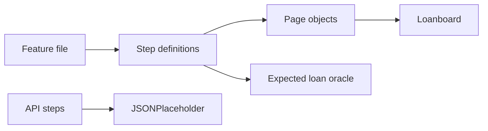

# Loanboard

Section A of the Streamhub fullstack and QA automation assessment: a small loan desk, a Playwright + Cucumber framework around it, boundary calls to JSONPlaceholder, and two SQL scenarios.

## Setup

Clone the repo and run these commands. They are the whole setup. You need Node.js 22 or newer, and an internet connection for `npm install`, the Playwright browser download, and the API tests.

```bash
git clone https://github.com/vgarg1998/streamhub-qa-assessment.git
cd streamhub-qa-assessment
node -v
npm install
npx playwright install chromium
```

`node -v` must print `v22` or higher. `npm install` stops with an error on an older Node. Install Node 22 from [nodejs.org](https://nodejs.org) and open a new terminal, then run the commands again.

If you use nvm, this repo has an `.nvmrc` file:

```bash
nvm install
nvm use
```

The app address is already in `.env`:

```text
BASE_URL=http://127.0.0.1:5173
API_BASE_URL=https://jsonplaceholder.typicode.com
```

If `.env` is missing, create it from the example:

```bash
cp .env.example .env
```

On Windows Command Prompt, that copy is `copy .env.example .env`.

Nothing else is required. Do not install a database. The SQL script uses SQLite built into Node 22.

## Run

Port **5173** must be free. The test command starts the website on that port.

See the app:

```bash
npm run dev
```

Then open [http://127.0.0.1:5173/](http://127.0.0.1:5173/) for the dashboard and [http://127.0.0.1:5173/report.html](http://127.0.0.1:5173/report.html) for the repayment report. Stop the server with Ctrl+C before running the tests, because they start the server themselves.

Run the tests that must pass. This needs the internet, because three scenarios call JSONPlaceholder.

```bash
npm test
```

A passing run ends with 9 scenarios passed. The HTML report is `reports/cucumber-report.html`. Screenshots are in `reports/screenshots/`. API responses are in `reports/api/`.

Run the SQL checks and refresh the result screenshots:

```bash
npm run sql
```

Screenshots are written to `sql/results/`.

These two commands are part of the self-healing exercise. The first one is supposed to fail. The second one should pass and does not change any test files.

```bash
npm run test:self-healing
npm run heal:poc
```

## Architecture

```text
tests/features        what the behaviour is          Gherkin
tests/steps           how a sentence maps to code    Cucumber
tests/pages           how to use one screen          Playwright locators
web/                  the app under test             Vite + TypeScript
tests/support/expected-loan.ts
                      the same EMI rules, copied on purpose
```

A step never contains a selector. A page object never imports the app. The expected EMI is computed again in `expected-loan.ts`, so a bug in `web/src/emi.ts` fails the test instead of hiding inside a shared function.



## The app

- **Dashboard** (`/`): principal, monthly EMI, total interest, total payment, and a pie chart of principal against interest.
- **Repayment report** (`/report.html`): form for amount, annual rate, and tenure, plus a year filter. Submitting recalculates the cards, a yearly bar chart, and the schedule table.

The default desk is 25,00,000 at 10% for 10 years. A query string such as `/?amount=5000000&rate=7.5&years=15` opens that loan directly. Calculating on the report stores the loan and the dashboard link carries it back.

### EMI rounding

The instalment is the reducing-balance formula, rounded to the nearest rupee:

```text
r = annualRate / 12 / 100
n = years * 12
EMI = round( P * r * (1 + r)^n / ((1 + r)^n - 1) )
```

The schedule then walks month by month, rounds each month's interest, and clears the remaining principal in the final month. Because of that, total interest can differ by a few rupees from `EMI × months − principal`.

For 25,00,000 at 10% for 10 years the instalment is **33,038**. The schedule's total interest is **14,64,500**, which is 60 rupees under `33,038 × 120 − 25,00,000`. The cards, the pie, and the test oracle all use the schedule figure so they agree with each other.

## API tests

`POST /posts` on JSONPlaceholder does not validate. A 5,000-character title, a title full of symbols, and a body with no `userId` all come back **201** with JSON and an `id`. The missing `userId` is absent from the response, not rejected.

The assessment text describes a validating API. Asserting 400 here would fail against the live service for the wrong reason. The scenarios assert the observed contract and still fail on a 5xx. See `tests/features/posts.feature`.

## SQL

Schema, seed, and queries are in `sql/`. `npm run sql` checks the result against the rows the queries are supposed to return, then writes:

- `sql/results/schema.png`
- `sql/results/scenario1.png` — round-trip transfers within 24 hours and 10%
- `sql/results/scenario2.png` — players with 30+ runs in at least three consecutive matches, and the date the streak started

Batting figures are synthetic IPL-style 2024 data, not official scores. A score of exactly 30 qualifies. Two separate streaks for the same player produce two rows.

## Self-healing locators

`tests/features/self-healing.feature` keeps five bad locators: a positional CSS path, an absolute XPath, a wrong button name, a wrong label, and a Highcharts selector this app does not use. They are tagged `@self-healing` and excluded from `npm test`, so the real suite stays green. They are still executed by `npm run test:self-healing`, and that run fails.

`docs/self-healing.md` describes detection, the prompt, and the checks that run before any fix would be applied. `npm run heal:poc` is the proof of concept.

## How this was built with an AI assistant

Cursor was used as a pair programmer after a first pass that turned the PDF into a written plan (`docs/LEARNING_AND_PLAN.md`). It scaffolded the page objects, the Cucumber glue, and the SQL, and it was corrected where it was wrong:

- The PDF's API section reads as if invalid posts should return an error status. JSONPlaceholder returns 201. The tests follow the live response.
- A first draft of the streak query subtracted a row number from the calendar date. That only works when events happen every day. The query that shipped uses the match sequence, so a low score between two good innings breaks the streak.
- `EMI × months − principal` is 14,64,560 for the 25 lakh case. The month-by-month schedule, which is what the chart shows, is 14,64,500. The oracle matches the schedule, and the closed-form EMI is locked to 33,038 and 46,351 so the formula cannot drift quietly.
- Cucumber treats parentheses in a step as optional text. A step written as `Principal Amount (USD)` did not bind. The step text changed; the broken locator still asks for that label.

The self-healing proof of concept does not call a remote model. It builds the prompt you would send, then a local reader of the accessibility snapshot proposes one locator. The validation step is the part that would stay if that reader were replaced by a model. Nothing is written back into the failing tests automatically.
